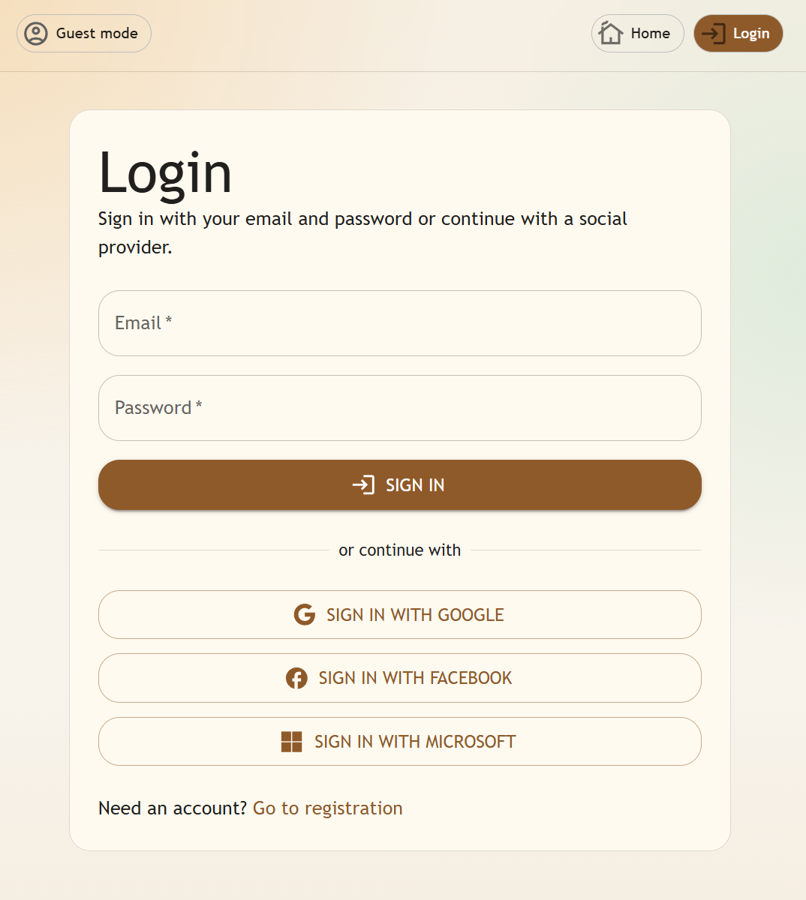
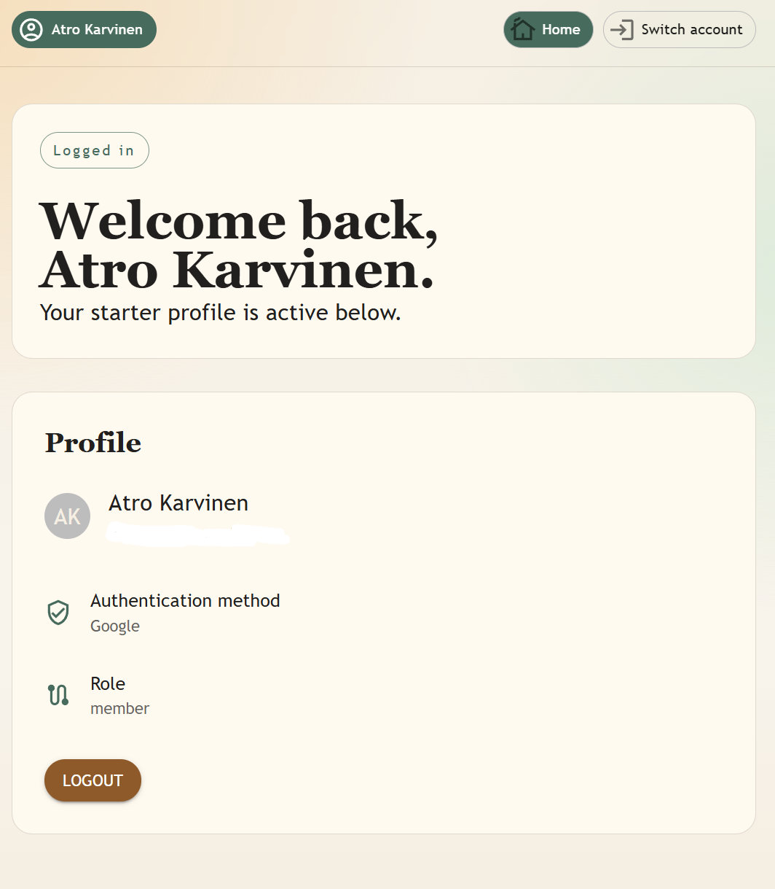

# App Authentication

A full-stack authentication demo for trying common account and sign-in flows. It connects a React client to an API and shows how the authenticated user and session state are reflected in the application.

## What This Demonstrates

- Registering an account with a display name, email, and password.
- Signing in with email and password, or with Google, Facebook, or Microsoft.
- Restoring the signed-in profile after a page reload and signing out.
- Displaying the current user's profile, authentication method, and role.

The app is intended as a demonstration and starter project for exploring authentication flows in a full-stack application. Social sign-in requires the relevant provider credentials and redirect configuration; availability depends on the local environment.

## Try the Demo

1. Open the login page and sign in with an existing account, or use registration to create one.
2. Alternatively, choose a configured social provider on the login page.
3. On the home page, inspect the active profile, sign-in method, and role.
4. Reload the page to see the session restored, then choose **Logout** to end it.

## Screenshots

### Login

The login page provides credential sign-in, social provider buttons, and a link to registration.



### Signed-in home page

The home page shows the authenticated profile, provider, role, and logout action.



## Run Locally

Install dependencies in the repository root and in both `client` and `server`, then start the client and API together from the repository root:

```sh
npm install
cd client && npm install
cd ../server && npm install
cd .. && npm run dev
```

Configure the server and any social sign-in providers for your environment before testing those flows.
